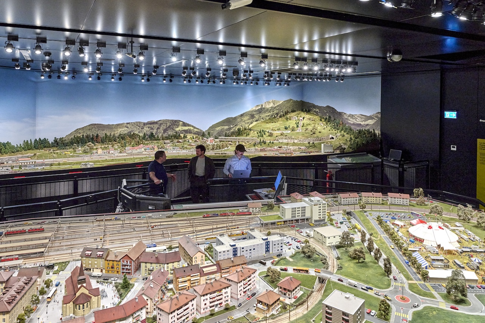
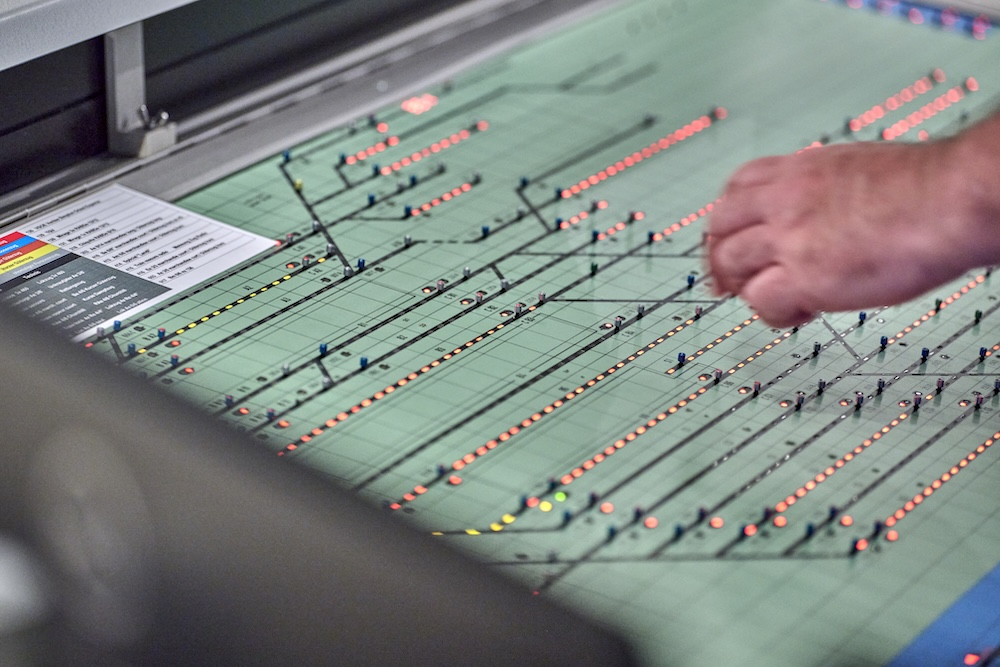
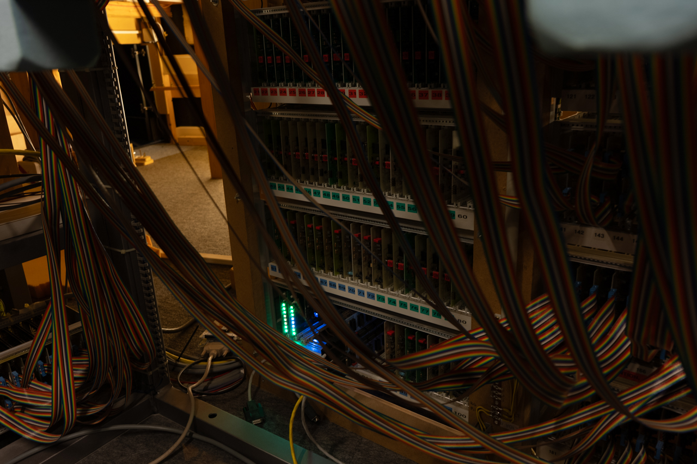

export const metadata = {
    title: "Model Railway Control System",
    description: "Model railway control system powering the entire Kaeserberg museum.",
    date: "Aug 2024",
}

import cfkRcd from "./assets/cfk-rcd.mp4"

The [Kaeserberg museum](https://kaeserberg.ch/en/) hosts one of Switzerland's largest model railway at a scale of 1:87. Beyond the impressive level of detail and craftsmanship, lays a complex system of over 2000 meters of track, 450+ switches, and 200+ trains.

The model was built over the course of 17 years using an off-the-shelf control system that was the best available at the time and has served them for more than 10 years. The system consists of many different electronic cards that are connected to every part of the railway in over 52km of cables. A total of 5 computers where connected in serial to control the entire system.

After the years, the DOS-based software became a concern as its support is not guaranteed. _It was time for a change_.

I was approached by the [University of Applied Sciences](https://www.heia-fr.ch/) of Fribourg which received the task to evaluate and propose a new system. I was responsible for the software architecture and development of the new system. I worked on this project for about 2 years.

# The challenges

The complexity of the cabling and the number of physical components made it unfeasible to replace the hardware. Luckily, this was not even necessary as the hardware was still working perfectly fine and all components were still available or had modern equivalents. This meant that I could focus on building a new control system and an interface that would be able to communicate with the existing hardware.

Another challenge is that since the museum is open to the public year-round, we had to ensure that the new system could be deployed without interrupting the museum's operation. This meant that we had to build the new system to be fully compatible with the hardware but also with the existing configuration and also ensure that the operators wouldn't have too steep of a learning curve for the new user interface.

# The solution

Fortunately, I had a lot of help from the department of electronics for the design of the hardware interface. The final design embedds an ESP32-S3 microcontroller and replaces the old serial interface card that was used to communicate with the computers. The microcontroller reads the data from the physical components and sends it to the central server over Wi-Fi. The interface also receives commands from the server and applies them on the railway. This distributed architecture allows us to have a single server that handles the interlocking, train positions tracking and other high-level logic while the microcontrollers handles the low-level communication with the physical components.

The control server is built in Rust and runs on a in-house Kubernetes cluster to ensure high availability. Everything was implemented from scratch guided by the existing configuration which first had to be reverse engineered.

For this, I combined the old documentation that was still available with two practical approaches: changing settings in the DOS software and observing how its behavior changed, and sniffing the serial bus traffic between the computers and the electronic cards. Together, this gave a clear picture of how the layout was described and how the cards had to be driven. The configuration was then migrated once into a database, which is now maintained through the new system.

# The user interface

The operators control the railway through a web application built with Vue.js. It shows a live view of the layout, with train positions, switch states and occupied blocks, updated in real time through gRPC-web. The interface keeps the concepts the operators already knew from the old software to keep the learning curve low, and since it runs in the browser, it can be used from any device, not only from the control desk.

<Video src={cfkRcd} title="One of the layout section during live traffic." />

# Today

The new system is fully in production and runs the entire Kaeserberg railway. The old DOS computers have been retired, and the museum no longer depends on hardware that can't be replaced.

The railway itself didn't change, but what runs it did. Visitors still see the same trains on the same tracks as before. Underneath, the system is now built on modern, maintained technology, which gives the museum room to extend it in ways the old software never allowed.